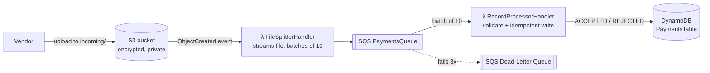

# Vendor Feed Processor


A **serverless AWS pipeline** that processes payment files sent by outside vendors. A file dropped into S3 is split into individual records, queued on SQS, then validated and stored in DynamoDB. Bad records are rejected with a reason, duplicates are ignored, and failures go to a dead-letter queue.

## 💡 Business problem

Banks receive payment files from many partners at unpredictable times. Some files are huge, some arrive in bursts, and some contain bad lines or are sent twice. The bank needs to:

- process every valid payment **exactly once**
- **never lose** a record when something fails
- **scale automatically** without running servers all day
- **protect account numbers** (PII)

## 🏗️ Architecture



## ✨ Key features

| Concern | Solution |
|---|---|
| Large files | Streams the S3 object line by line, never loading it fully into memory |
| Throughput | `SendMessageBatch` (10 per call) and SQS batch triggers |
| Bad data | Validated (fields, account format, amount, currency, date) and stored as `REJECTED` with a reason, without retrying |
| Duplicates | DynamoDB conditional write `attribute_not_exists(recordId)` makes processing idempotent |
| Transient failures | **Partial batch responses**: only failed messages are retried, and after 3 tries they go to the **DLQ** |
| Security | Least-privilege IAM per function, encrypted S3 and DynamoDB, public access blocked, account numbers masked in logs |
| Cold starts | Java 21 on arm64 with **Lambda SnapStart** |
| Infrastructure as code | Everything is defined in `template.yaml` (AWS SAM) |

## 🧰 Tech stack

Java 21 · AWS Lambda · Amazon S3 · Amazon SQS (with DLQ) · Amazon DynamoDB · AWS SDK for Java v2 · AWS SAM · IAM · JUnit 5 · GitHub Actions

## ▶️ How to run

**Unit tests (no AWS needed):**

```bash
mvn test
```

**Deploy to your AWS account** (needs the AWS CLI and SAM CLI configured; the free tier covers this demo):

```bash
mvn package
sam deploy --guided --stack-name vendor-feeds      # use a lowercase stack name
aws s3 cp samples/vendor_payments_2026-11-02.txt s3://<BucketName>/incoming/
aws dynamodb scan --table-name <TableName>
```

The sample file has 7 lines: 4 valid, 2 rejected (bad account, negative amount) and 1 duplicate that is ignored.

**Clean up:** `sam delete --stack-name vendor-feeds`

## 📄 File format

```
recordId|vendorId|accountRef|amount|currency|valueDate
PAY-0001|VEND-ACME|123456789012|1500.25|USD|2026-11-02
```

## 🔭 Next improvements

- CloudWatch alarm on DLQ depth, with an SNS alert
- AWS Lambda Powertools for structured logging and metrics
- Store a file-level summary (received, accepted, rejected) for each feed
- Integration tests with LocalStack

---
*Personal project by [Vasu Rayudu](https://vasurayudu-java.github.io), showing the serverless integration patterns I use professionally.*
